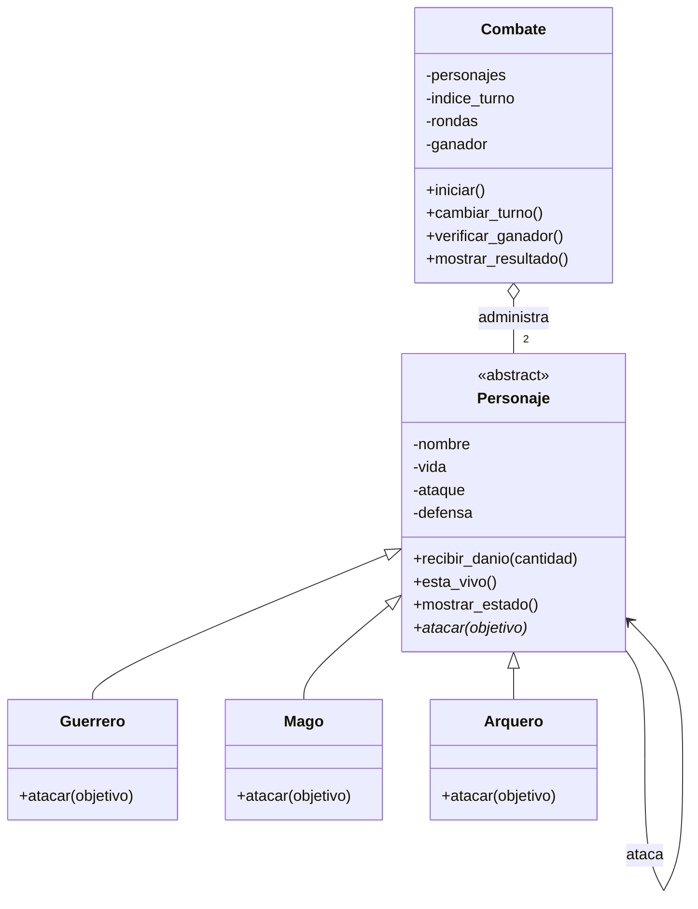

# Guardians of the Ancient Kingdom
## Sistema de combate por turnos en Python

### 1. Descripción
Este proyecto simula enfrentamientos entre guardianes de un reino fantástico. Cada personaje tiene vida, ataque y defensa. El programa aplica las habilidades de cada clase, cambia los turnos y anuncia el resultado.

### 2. Archivos
- `personajes.py`: contiene la clase abstracta `Personaje`, las clases `Guerrero`, `Mago` y `Arquero`, y el administrador `Combate`.
- `main.py`: crea ejemplos, muestra ataques, prueba algunas validaciones y ejecuta combates.
- `test_personajes.py`: contiene pruebas automatizadas opcionales con Pytest.

### 3. Responsabilidad de las clases
- `Personaje`: concentra los datos comunes, valida sus valores y controla la recepción de daño.
- `Guerrero`: aumenta el ataque un 20 % y luego resta la defensa del rival.
- `Mago`: hace un daño igual a su ataque, sin descontar defensa.
- `Arquero`: duplica la diferencia entre ataque y defensa solamente si el ataque supera la defensa.
- `Combate`: alterna los turnos, revisa si hay ganador y detiene el enfrentamiento cuando corresponde.

### 4. Relaciones entre clases
- **Herencia:** `Guerrero`, `Mago` y `Arquero` heredan de `Personaje`, porque comparten características y comportamientos.
- **Asociación:** un personaje interactúa con otro cuando lo ataca.
- **Agregación:** `Combate` recibe objetos de personajes creados por fuera y los administra; no necesita construirlos dentro de su clase.

### 5. Conceptos de POO
- **Abstracción:** `Personaje` establece lo que todo guardián debe tener y hacer sin definir una única manera de atacar.
- **Encapsulamiento:** los atributos se guardan con nombres privados y se consultan o modifican mediante propiedades que validan los datos.
- **Herencia:** las clases concretas reutilizan las reglas comunes de `Personaje`.
- **Polimorfismo:** `Combate` llama a `atacar()` sin preguntar qué tipo concreto es el atacante. Cada clase aplica su propia regla.

### 6. Lógica del combate
Cada ronda permite que los dos participantes ataquen, siempre que sigan vivos. El daño se calcula en la clase del atacante y `recibir_danio()` limita la vida a cero. Si una ronda completa causa cero daño, hay empate técnico. Si no hay ganador después de 50 rondas, se declara empate por límite.

### 7. Cómo ejecutar
1. Instala Python 3.
2. Descarga o clona este repositorio.
3. Abre una terminal en la carpeta del proyecto.
4. Ejecuta `python main.py`.

### 8. Pruebas
Las demostraciones básicas se ejecutan con `python main.py`. Para las pruebas automáticas, instala Pytest y ejecuta:

```bash
python -m pip install pytest
python -m pytest -v
```

Las pruebas verifican creación de personajes, valores inválidos, daño de cada clase, vida mínima, bloqueo de ataques de personajes derrotados, resultado de combate y empate técnico.

### 9. Diagrama de clases UML
El siguiente diagrama resume las clases principales y sus relaciones:



El símbolo de herencia muestra que las tres clases concretas derivan de `Personaje`. La agregación indica que `Combate` administra dos objetos ya creados. La flecha entre personajes representa la interacción durante un ataque.

### 10. Reto de abstracción
`atacar()` es abstracto porque los guardianes no hacen el mismo tipo de daño: el Guerrero potencia su ataque, el Mago ignora la defensa y el Arquero puede duplicar el daño. La clase base obliga a que todos tengan esa operación, pero deja que cada subclase la implemente según su habilidad. Esto permite usar polimorfismo en `Combate`.

En cambio, `recibir_danio()` puede estar implementado en `Personaje` porque todos reciben daño con la misma regla general: validar que la cantidad no sea negativa, restarla de la vida y evitar que la vida baje de cero. Así no se repite código en las subclases.

### Comprobación del ejemplo del enunciado
Cuando Arthas ataca a Gandalf, el daño es `30 × 1.20 - 10 = 26`, porque Gandalf tiene 10 puntos de defensa. Cuando Gandalf ataca a Arthas, causa 40 de daño porque la habilidad del Mago ignora la defensa. El código aplica las fórmulas indicadas en los requerimientos.
